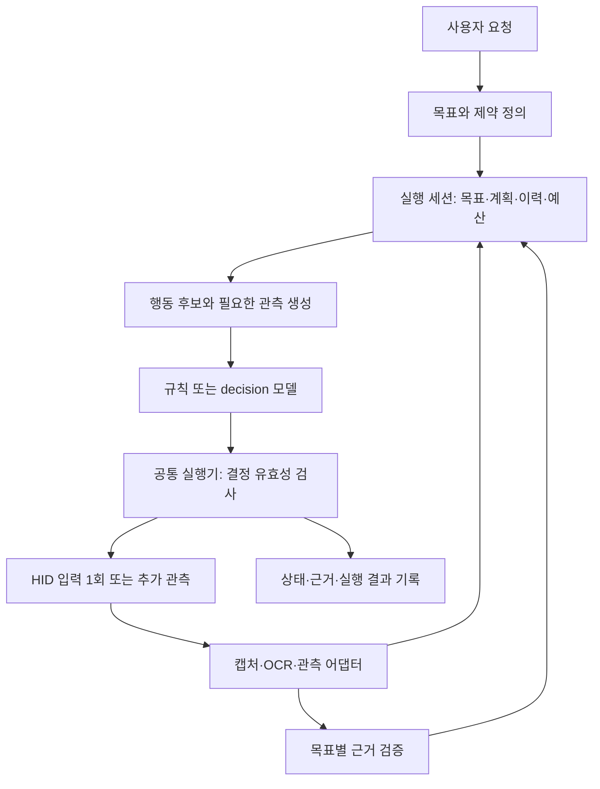

# Windows 제어 에이전트 설계

기준일: 2026-11-18. 사용자와의 실행·검증, task별 판정, decision 모델 및 “what to do differently” 논의를 반영한다. 이 문서는 최신 설계 기준이며, 초기 조사 및 실제 시험 기록을 대체하거나 과거 시험 성공 범위를 확대하지 않는다.

## 1. 목표와 설계 변경

사용자 목표와 현재 관측을 바탕으로 다음 행동을 선택하고, 결과에 따라 계속 진행하거나 다른 접근을 선택하는 에이전트를 만든다. Raspberry Pi는 HDMI 캡처·OCR·USB HID를 담당한다. 평상시 이벤트 처리와 사용자 요청의 통합은 최종 목표이며, 상주 수신·선점 기능은 아직 구현하지 않았다.

대화에 따른 설계 변경은 다음과 같다.

| 논점 | 최신 설계 |
|---|---|
| task마다 동일한 단어 검사 | 공통 실행 규칙과 목표별 의미 검증을 분리한다. 단어 출현만으로 범용 성공을 선언하지 않는다. |
| task마다 전용 검증 코드 작성 | 공통 판정 연산과 선언적 목표 조건을 우선 사용한다. 표현할 수 없는 경우에만 전용 어댑터를 추가한다. |
| decision 모델 적재로 범용화 | 모델은 판단 후보를 제공한다. 목표 정의·후보 생성·관측 근거·실행 제약·평가가 함께 필요하다. |
| what to do differently | 관측·실패 원인·행동 이력을 다음 결정에 전달하는 실행 세션으로 공통화한다. 구체적인 대안은 목표 정의·정책·모델이 제공한다. |
| 검증 실패 즉시 종료 | 현재 단일 행동 실행기는 종료한다. 후속 세션은 원인을 분류해 추가 관측·계획 수정·중단을 선택한다. 불명확한 행동의 자동 재실행은 금지한다. |
| 하드웨어 준비가 개발 전제 | 현재 PC의 재생 환경에서 판단·실행 규칙을 개발한다. 합성 재생과 실제 장치 검증은 구분한다. |

현재 Rust 구현은 단일 행동 Execute and Validate 기반이며, 명시적 어댑터의 허용 후보를 탐색하는 [상태 전이 탐색기](exploration.md)가 추가되었다. 아래의 범용 목표 계약·모델 후보 선택·목표 지향 다단계 세션·모델 연결은 후속 설계이며 구현 완료를 의미하지 않는다.

## 2. 책임과 배치

| 구성 요소 | 책임 | 맡기지 않는 책임 |
|---|---|---|
| 목표 해석/계획 | 요청을 목표·제약·단계로 표현 | 근거 없는 완료 선언 |
| 관측 어댑터 | 프레임·OCR 박스·영역·관측 품질 제공 | 화면에 없는 내부 상태 추측 |
| 후보 생성 | 현재 관측에서 식별 가능한 대상과 허용 행동 제시 | 모델이 임의 좌표/명령을 만들어 즉시 실행 |
| decision 모델/규칙 | act/wait/reobserve/revise_plan/finish/stop 제안 | HID 직접 접근, 실행 제한 해제 |
| 공통 실행기 | 직렬 입력, 프레임/대상/인자 검사, deadline, 재관측, 중복 방지 | 모든 task에 같은 성공 문구 적용 |
| 목표 검증 | 목표와 일치하는 새 근거 평가 | 모델 점수만으로 사실 확정 |
| 독립 채점기 | 정답 상태와 행동 수로 결과 평가 | DOM·oracle 정답을 에이전트 입력에 섞기 |

개발 시 테스트 웹 서버는 현재 작업 PC에서 LAN으로 제공하고 제어 대상 PC 브라우저에서 짧은 HTTP 주소를 연다. Pi에는 테스트 웹 서버를 실행하지 않는다. 모델 판단은 먼저 현재 PC에서 재생 관측으로 평가한다. Pi 모델 적재는 별도 요청과 자원 실측 후 결정한다.

## 3. 관측과 목표 계약

다음은 논리적 데이터 계약이며 확정된 Rust API나 파일 형식은 아니다.

### 관측

- frame_id, 수집 시작/완료 시각, 해상도, OCR 박스·confidence, 관측 오류.
- 후속 확장: 앱/창/영역 식별 근거, 대상 ID, 텍스트 간 관계, 관측 범위와 가려짐 여부.
- 대상 ID는 프레임에 종속한다. 입력 직전 현재 프레임과 대상 ID를 대조하며, 화면 전환 후 예전 좌표를 재사용하지 않는다.
- 관측한 사실과 모델이 추론한 상태를 분리한다. 해석이 어려운 경우 unknown을 유지한다.
- 현재 live의 frame_id/시각은 수집 호출 기준이다. 장치 내부 캐시나 실제 HDMI 촬영 시각의 신선함까지 보장하지 않는다.

### 목표 계약

- goal_id와 계약 버전, 대상 앱/문서/객체 식별 조건, 사용자 제약.
- 실행 전제조건과 행동 가능한 범위, 단계별 기대 변화.
- 성공 조건, 명시적 실패 조건, 추가 관측이 필요한 조건.
- 허용 행동·부작용 분류·재실행 정책, 전체 deadline과 단계별 예산.
- 성공을 확인하는 데 필요한 증거 종류와 출처. 관측할 수 없는 조건은 unknown으로 둔다.

공통 연산의 초기 후보는 영역 내 존재/고유성/값 일치/관계, 행동 전후 변화, 새 관측에서의 조건 충족이다. 화면 밖·가림·OCR 누락 가능성이 있으면 “텍스트 미검출”을 “대상 부재”로 확정하지 않는다. 대기 연산으로 안정된 여러 관측을 요구할 수 있으나, 같은 잘못된 관측을 반복해도 사실성이 증명되지는 않는다.

모델이 제안한 계약도 검사 대상이다. 사용자 목표의 대상·값·범위를 누락하거나 성공 조건을 더 쉬운 문구로 바꾸어서는 안 된다. task마다 새 코드를 만드는 대신 검증된 연산을 조합하고, 화면별 지식은 데이터/어댑터로 둔다.

## 4. 목표별 검증

| 목표 | 필요한 근거 예 | 불충분한 근거 예 |
|---|---|---|
| 웹페이지 열기 | 목표 주소와 페이지 고유 요소가 같은 관측 맥락에서 확인됨 | 제목 일부나 임의 READY 문구 |
| 검색 | 해당 검색어/필터 반영, 결과 영역 갱신, 결과 또는 명시적 결과 없음 | 화면 어딘가의 결과 개수 |
| 파일 저장 | 올바른 파일명/대상 문서와 연결된 저장 완료 근거 | 대화상자 종료만 확인 |
| 설정 변경 | 해당 항목이 목표 값임을 변경 후 관측에서 확인 | 클릭 전송 완료나 체크 표시 하나 |
| 팝업 처리 | 올바른 팝업/객체 식별, 해당 선택 후 예상 후속 상태 | 팝업이 사라졌다는 사실만 확인 |

기록 목록의 이전 COMPLETED나 다른 창의 완료 문구는 현재 task의 근거가 아니다. 영역·대상 객체·행동 후 시각과 연결해야 한다. 저장 파일 존재처럼 화면만으로 확정하기 어려운 목표는, 승인된 추가 관측 채널이 없으면 판정 불가로 남긴다.

현재 MVP의 전역 FAILED 금지와 required 일부가 이미 보이면 거부하는 규칙은 보수적인 재생/단일 행동 정책이다. 이를 범용 규칙으로 고정하지 않는다. 정상 설명의 FAILED는 실패가 아닐 수 있고, 다단계 목표의 일부가 이미 달성된 것은 정상일 수 있다. 후속 계약에서는 영역/맥락과 단계 진행 상태로 평가한다.

판정 결과는 met / unmet / pending / unknown과 근거를 반환한다. 전체 목표가 충족된 met만 성공으로 연결한다. 모델의 finish 제안은 검증 요청이며 성공 판정 자체가 아니다. 명시적 실패 또는 deadline 종료는 실패이고, 입력 결과가 불명확하면 미확인 상태를 함께 기록한다.

## 5. 공통 실행 세션과 what to do differently

세션은 목표 계약, 현재 단계/계획 버전, 관측 이력, 입력 시도, 판정 근거, 남은 예산을 보유한다. 한 번 입력한 뒤 반드시 새 관측으로 돌아온다. 계획을 바꿔도 원래 목표와 전체 deadline은 유지한다.

| 결정 | 공통 처리 |
|---|---|
| act | 후보 ID·현재 프레임·인자·전제조건·허용 부작용 검사 후 입력 1회 |
| wait | 제한된 시간 동안 입력하지 않고 새 관측. 화면 전환을 고정 대기로 추정하지 않음 |
| reobserve | 추가 프레임 또는 허용된 다른 영역/관측 방법으로 근거 확보 |
| revise_plan | 실패/차이와 이력을 반영해 남은 단계를 수정. 바로 입력하지 않음 |
| finish | 목표 계약 전체에 대한 근거 검증. 미충족/불명확하면 성공 거부 |
| stop | 실패·차단·취소 이유 및 마지막 확인 상태를 기록하고 입력 중단 |

모델 결정에는 decision_id, goal/plan 버전, based_on_frame_id, 후보 ID, 기대 결과, evidence 참조를 포함한다. 실행기가 승인한 현재 후보만 선택할 수 있다. 낮은 신뢰도·지원하지 않는 결정·계약 위반은 추가 관측 또는 차단으로 처리한다. 화면의 텍스트는 관측 데이터이며 실행 정책을 바꾸는 지시로 취급하지 않는다.

### 상황별 대안 선택

| 관측/문제 | 공통 실행기의 역할 | 목표/정책/모델이 공급하는 지식 |
|---|---|---|
| 로딩 표시 | 예산 내 대기·재관측 | 해당 표시가 진행 중이라는 의미 |
| 잘못된 페이지 | 목표와 차이 전달, 계획 수정 검증 | 올바른 페이지로 가는 경로 |
| 저장 권한 오류 | 실패 근거 기록, 대안 허용 여부 검사 | 다른 저장 경로가 사용자 요청에 부합하는지 |
| 덮어쓰기 확인 | 부작용 정책에 따라 차단/승인된 선택 수행 | 덮어쓰기 허용 여부 |
| 모호한 대상 | 입력 금지, 추가 관측 | 필요한 영역/문맥 |
| 입력 후 관측 소실 | 미확인 기록, 읽기 전용 관측 우선 | 결과 확인 방법 또는 중단 판단 |

공통화하는 것은 상황 차이를 다음 판단으로 돌려보내는 절차다. 적합한 대안 자체를 하드웨어 실행기가 자동으로 알아내는 것은 아니다.

중요한 제한:

- timeout은 실패다. 계획 수정으로 실패한 단계를 자동 재시작하거나 예산을 리셋하지 않는다.
- 입력 실패도 부분 전달 가능성이 있다. “안 됐으니 다시 클릭”하지 않는다.
- 불명확한 부작용은 계획 버전이나 행동 ID를 새로 만들어도 같은 의미의 재실행이 될 수 있다. 객체·의도·인자와 이력을 함께 비교한다.
- 다른 행동이더라도 후속 부작용의 전제가 확인되지 않았으면 실행하지 않는다. 추가 관측은 우선 읽기 전용으로 한다.
- 무한 대기/관측/계획 수정을 막기 위해 전체 시간·단계·무진전 횟수 예산을 둔다. 정책으로 해결할 수 없는 모호함만 사용자에게 확인한다.

## 6. Decision 모델과 Laya

decision 모델은 목표·현재 관측·과거 행동·검증 결과·허용 후보를 입력받는다. 목표 분해나 후보 생성은 별도 책임으로 남기되, 검증된 모델이 해당 기능을 제공하면 같은 계약을 통해 연결할 수 있다. 하나의 모델을 선택/계획/검증에 쓰더라도 책임과 결과 기록은 분리한다.

Laya는 후보 판단 모듈의 평가 대상이다. 적재만으로 미지 task의 계획·대상 식별·성공 판정을 보장한다고 가정하지 않는다. 모델 점수는 실행 결과의 사실 증명이 아니다. 현재 소스에는 모델을 설치하거나 연결하지 않았다.

평가할 버전·체크포인트·입력 표현·후보 순서·실행 경로를 고정하고, 거부/판정 보류 능력까지 측정한다. 관측이 부족한 문제는 모델 확신으로 채우지 않는다. 모델 및 학습 데이터에 관한 외부 설명은 [Laya 공식 저장소](https://github.com/NandhaKishorM/laya)를 확인하며, 특정 버전의 정확도나 다른 장치의 속도를 Pi 성능으로 해석하지 않는다.

## 7. 현재 구현과 후속 구현

| 영역 | 현재 상태 | 다음 확장 |
|---|---|---|
| 관측 | 수집 호출 ID/시각·해상도·OCR 박스 | 영역/대상/앱 맥락과 관측 품질 |
| 실행 | 단일 입력 시도와 새 관측 검증, CLI 소유권 잠금, 제한된 어댑터 기반 전이 탐색 | 목표 지향 다단계 세션·목표/계획 버전·의미상 중복 검사 |
| 판정 | 단어 required/forbidden, 신선함·좌표·deadline 검사 | 목표 계약과 영역/관계/변화 기반 연산 |
| 오프라인 | 합성 TSV 재생, 합성 UI 그래프 탐색, 가상 클릭, 보고서 | task별 관측 묶음·목표 지향 결정 재생·미지 task 평가 |
| 판단 | CLI 인자와 고정 정책 | 규칙/모델 교체 가능한 결정 인터페이스 |
| 이벤트 | 최종 목적에 포함 | 세션 기반이 검증된 뒤 큐·안전 경계 선점 |

기존 단일 행동 검증기는 다단계 세션의 한 단계 실행기로 재사용한다. 현재 Policy/Report를 범용 목표 계약/세션으로 이미 구현된 것처럼 취급하지 않는다. 과거 `agent.rs`의 화면 변화 감지는 의미적 성공 판정을 대체하지 않는다.

## 8. 개발 순서와 평가

1. 목표 계약과 근거 판정 연산을 현재 PC에서 구현한다. 완료 문구가 다른 영역/과거 기록에 있는 혼동 사례부터 추가한다.
2. 기존 실행기를 감싸는 세션과 결정 형식을 구현한다. 성공·진행·실패·판정 불가, 입력 후 관측 소실, deadline/계획 수정/중복 행동을 재생한다.
3. 규칙 기반 판단으로 세션을 검증한 뒤 같은 입력/출력 계약에 decision 모델을 연결한다. 모델 설치·선정·추가 의존성은 별도 요청 범위다.
4. 학습·설정에 사용하지 않은 task, 앱 화면·배율·문구 변화에서 평가한다. 모델 입력에 정답 oracle은 넣지 않는다.
5. 실제 Pi 소스 실행 → 재캡처/OCR/이미지 확인 → 상태 정의로 HDMI/HID 경로를 별도로 검증한다. 처리 시간·RSS는 실제 장치에서 측정한다.
6. 목표별 검증과 세션이 안정된 후 상주 이벤트 처리와 선점을 확장한다.

평가 지표는 task 성공률, 거짓 성공률, 잘못된/중복 입력 수, 판정 불가 비율, 대안 선택 후 복구 성공률, 단계 수와 지연이다. 성공률을 높이기 위해 판정 불가를 성공으로 합치지 않는다. 같은 관측에서 규칙/모델을 비교하고, 알려진 task와 미지 task의 결과를 분리한다.

저장 TSV 재생은 제어 로직을, 저장 화면 재OCR은 인식 경로를, 현재 PC 브라우저 통합은 화면 반응을, 실제 HDMI/HID는 물리 경로를 검증한다. 각 계층의 결과를 독립 기록하며 미수행 항목을 완료로 쓰지 않는다.

## 관련 문서

- [화면 전이 탐색기](exploration.md): BFS 탐색·현재 프레임 대상 해석·복원 검증·부분 그래프 저장과 구현 경계.

- [금융 지표 검색·수집 task](../tasks/financial-search/README.md): 4개 검색엔진의 지표 탐색/출처/최신성 검증 명세. 실제 자동 실행 완료를 의미하지 않는다.

- [초기 조사와 설계](2026-11-13-feasibility.md)
- [실행·검증 진행 기록](superpowers/plans/2026-11-13-execute-validate.md)
- [현재 오프라인 구현 사용법](offline-validation.md)
- [오프라인 구현 계획과 검증 기록](superpowers/plans/2026-11-18-offline-validation.md)
