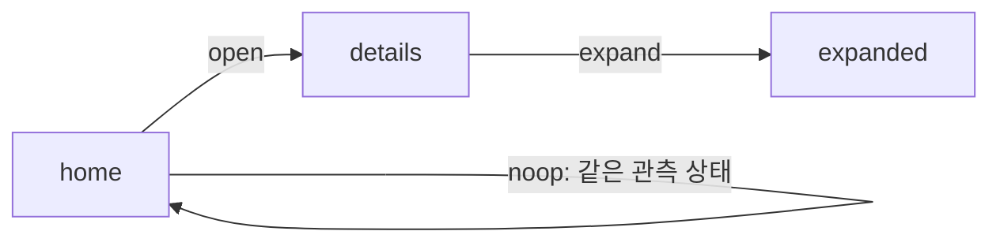

# 화면 상태 전이 탐색기

## 구현 범위

`src/exploration.rs`는 관측 → 미탐색 후보 선택 → 입력 1회 → 새 관측 → 그래프 기록 → 복원 확인을 수행하는 공통 Rust 탐색기다. 표준 라이브러리와 기존 Observation/프레임 검사·OCR·HID를 사용하며 새 모델/의존성은 추가하지 않았다.

상태와 대상의 의미는 `Environment` 어댑터가 공급한다. 현재 제공 어댑터는 결정적 합성 UI와 저장소의 폐기 가능한 테스트 웹앱이다. 일반 앱의 객체 검출·전체 픽셀 탐색·자연어 계획기를 구현한 것은 아니다.

## 하드웨어 없는 실행

```powershell
cargo run --offline -- explore-demo target/explore-demo-01
cargo run --offline -- explore-demo target/explore-unknown-01 unknown
cargo run --offline -- explore-demo target/explore-restore-error-01 restore-error
cargo run --offline -- explore-demo target/explore-input-error-01 input-error
```

출력 디렉터리는 존재하지 않는 새 경로여야 한다. 정상 데모는 3개 상태·3개 탐색 간선을 발견하고 3회 복원한다. 더 깊은 상태에 도달하는 경로 재실행까지 합쳐 입력은 7회다. 데모 시간은 가상 시간이며 실제 Pi 성능 측정값이 아니다.



`delete` 후보는 금지되어 입력하지 않는다. unknown은 입력 후 상태 불명확, restore-error는 복원 상태 불일치, input-error는 부분 입력 가능 오류를 재현한다. 모두 자동 재입력하지 않고 부분 그래프를 저장한다.

## 실제 테스트 웹앱 탐색

Pi에서 수정 소스를 빌드한 작업 디렉터리에서 실행한다.

```sh
cargo run --offline -- explore-test-web explore-live-01 1
```

이 명령은 실제 HID 입력을 수행한다. **저장소의 테스트 웹앱이 제어 PC 전면에 열려 있고 SUCCESSMODE/READY 상태인 경우에만** 후보를 실행한다. 테스트 웹 서버는 현재 작업 PC에서 제공하며 Pi에는 서버를 띄우지 않는다. 전제 화면이 아니면 제한된 재관측 후 unknown_state로 종료하고 입력하지 않는다.

- OCR에서 Execute/Validate 및 고유 mode/phase 문구를 확인한다. 이는 이 테스트 앱만을 위한 계약이며 임의 웹페이지의 신원/동작을 보장하는 범용 검증은 아니다.
- ready 상태에서는 RUN과 다른 시나리오 전환 버튼을 탐색 후보로 만든다. confirm 상태에서는 CONFIRM만 선택한다. completed/failed 상태는 추가 후보를 만들지 않는다.
- 동일 문구가 둘 이상이거나 신뢰도가 낮으면 해당 후보의 permission을 unknown으로 두어 클릭하지 않는다. 낮은 신뢰도의 CONFIRM이 보이면 밑의 RUN을 선택하지 않고 화면 전체 판정을 보류한다.
- WAITING은 과도 상태로 두고 제한적으로 재관측한다. 진행이 끝나지 않으면 불명확 상태로 중단한다.
- 복원은 이미 관측한 폐기 가능한 페이지에 Ctrl+R 한 번을 전송한다. 입력 초점을 확인하지 않은 문자열 입력이나 브라우저 뒤로가기 체인은 사용하지 않는다. 이후 새 관측에서 처음의 success_ready가 확인되어야 다음 탐색을 허용한다. 브라우저가 폼 선택을 유지하는 등 복원 결과가 다르면 중단한다.
- max-probes는 1~30이다. 작은 값으로 시작한다. 한도에 도달하면 probe_limit/종료 코드 1로 부분 결과를 남긴다. 이는 전체 탐색 완료가 아니다.

이 어댑터의 ready 상태 정의에는 외부 파일/계정/저장 부작용이 포함되지 않는다. 같은 reset을 실제 업무 앱에 적용하지 않는다.

## 어댑터 계약

```rust
pub trait Environment {
    fn now(&self) -> Duration;
    fn observe(&mut self) -> Result<Scene, String>;
    fn act(&mut self, candidate: &Candidate) -> Result<(), String>;
    fn restore(&mut self) -> Result<(), String>;
    fn pause(&mut self) {}
}
```

`Scene`은 Observation, 확인된 state ID 또는 None, 후보 목록이다. 후보는 안정적인 locator key, 현재 frame_id, 원본 이미지의 `[x,y,w,h]`, Allowed/Denied/Unknown을 가진다. 내부는 승인된 사각형의 중앙을 클릭 지점으로 사용하므로, 어댑터는 그 지점이 조작 대상으로 적합한 경우에만 Allowed를 주어야 한다.

어댑터 구현자가 보장해야 할 사항:

- state ID는 앱/단계/관련 입력값/스크롤·팝업 등 재현에 필요한 맥락을 포함한다. 같은 ID로 다른 의미의 화면을 뭉개면 탐색기도 구별할 수 없다. 이미지 유사도만으로 확정하지 않는다.
- 후보 key는 프레임 간 같은 행동을 가리키는 locator다. 좌표 자체를 key로 쓰거나 raw OCR 전체를 ID로 넣지 않는다. ID는 64바이트 이내의 ASCII 영숫자 및 `_ - . :`만 허용한다.
- Allowed는 명시적으로 탐색이 허용되고 복원 가능한 행동에만 부여한다. 모양을 검출했다는 이유만으로 Allowed를 주지 않는다.
- restore는 출발 맥락을 되돌리는 허용된 동작이어야 한다. 여러 UI 단계가 필요하면 어댑터 내부에서도 각 전환을 재관측해야 한다. 반환 코드만으로 복원 성공을 뜻하지 않는다.
- now는 단조 증가 시간이고 capture 시각과 같은 기준이다. observe/act/restore 호출 자체도 외부 프로세스·장치별 제한 시간이 있어야 한다. 공통 탐색기는 반환하지 않는 콜백을 강제 중단하지 못한다.
- 민감 OCR 원문을 식별자나 오류 로그에 넣지 않는다. 실제 어댑터는 frame JPEG를 로컬 실험 출력에만 저장하고 전체 OCR TSV를 출력하지 않는다.

## 탐색과 상태 기록

1. 첫 확인 상태를 root로 등록하고 허용 후보를 frontier에 추가한다.
2. 탐색 대상 노드가 root가 아니면 기록된 경로를 따라간다. 각 단계에서 현재 후보를 다시 찾아 입력하고 예상 도착 상태를 재관측한다. 과거 좌표를 재사용하지 않는다.
3. 후보의 frame_id·좌표·permission·관측 신선함을 검사하고 탐색 입력을 1회 시도한다.
4. 결과가 불명확하면 읽기 전용 재관측만 수행한다. 기본 추가 관측은 2회이며, 그래도 알 수 없으면 간선을 unconfirmed로 남기고 종료한다. 입력 오류도 사후 관측을 시도하며 재실행하지 않는다.
5. 새 상태면 노드를 추가하고 그 상태의 첫 관측 후보를 큐에 넣는다. 이미 아는 상태는 합친다. 따라서 동적으로 다른 후보가 나타나는 맥락은 별도 state ID로 정의해야 한다.
6. root 복원을 실행하고 새 관측으로 확인한다. 실패·불명확 시 다음 후보를 누르지 않는다.

같은 관측 상태로 돌아오는 간선은 `same_observed_state`다. 버튼이 무효이거나 내부 부작용이 없다고 확정한 것이 아니다. 기능 이름 추론과 관측된 전이 기록은 구분한다.

## 예산과 중단

기본 한도는 timeout 180초, 프레임 최대 나이 30초, 전체 입력 100회, 탐색 probe 30회, 상태 64개, 관측 300회다. live 어댑터는 요청한 probe 수에 따라 전체 deadline을 180초×probe 수(최대 1800초)로 설정한다.

입력 횟수는 탐색뿐 아니라 경로 이동과 복원, 실패한 입력 시도도 포함한다. 입력 전 사후 관측 1회분을 확보한다. 입력이 deadline을 넘겨 끝나면 진단 관측을 한 번 시도한 후 timeout으로 종료한다. 이 진단 때문에 종료가 관측 프로세스 제한 시간만큼 늦어질 수 있으며 성공으로 처리하지 않는다.

complete는 **어댑터가 처음 관측에서 제시한 허용 후보와 발견한 상태의 frontier를 모두 처리했다**는 뜻이다. 앱의 모든 픽셀·숨은 상태·기능을 발견했다는 뜻이 아니다. 입력/상태/프레임/탐색 한도, 관측 오류, 경로/복원 불일치는 부분 결과와 함께 비정상 종료 코드 1을 반환한다.

## 출력 파일

| 파일 | 내용 |
|---|---|
| report.json | 모드·종료 이유·노드/간선/입력 수·복원 여부·미탐색 수 |
| graph.dot | Graphviz 그래프 |
| graph.mmd | Mermaid 그래프 |
| nodes.tsv | 확인된 상태 ID |
| edges.tsv | 탐색 행동·좌표·전/후 frame_id·결과 |
| attempts.tsv | 탐색/경로 이동/복원 입력 시도와 반환 성공 여부 |
| pending.tsv | 아직 실행하지 않은 상태/행동 |
| skipped.tsv | 금지·불명확 권한으로 제외한 후보 |
| frame-NNNN.jpg | live에서 실제 관측한 화면. 데모에는 생성하지 않음 |

간선의 unconfirmed 자리표시는 확인된 노드 수에 포함하지 않는다. `acknowledged`는 입력 함수가 성공 반환했다는 뜻이며 UI 성공 판정이 아니다. restored도 마지막 초기화 결과를 새 관측으로 확인했을 때만 true다. 이미지·OCR 원문은 그래프 텍스트에 포함하지 않는다.

## 검증

`tests/exploration.rs`: 깊은 상태 도달, 같은 관측 상태 간선, 복원 확인, 금지 후보, stale 좌표, 불명확/입력 실패, 예산과 입력 후 강제 관측을 시험한다.

`tests/exploration_cli.rs`: 정상/불명확/복원 실패/입력 실패 데모의 그래프 저장과 기존 증거 디렉터리 덮어쓰기 거부, 실제 CLI 잘못된 인자의 장치 접근 전 거부를 시험한다.

`tests/exploration_web.rs`: 테스트 앱 식별·중복 RUN 거부·WAITING 보류·팝업/저신뢰 상태 처리를 합성 OCR로 시험한다. 이 테스트 통과는 실제 OCR 인식률이나 복원 성공을 입증하지 않는다. 실제 측정 결과는 [구현 기록](superpowers/plans/2026-11-18-exploration.md)에 별도로 남긴다.
